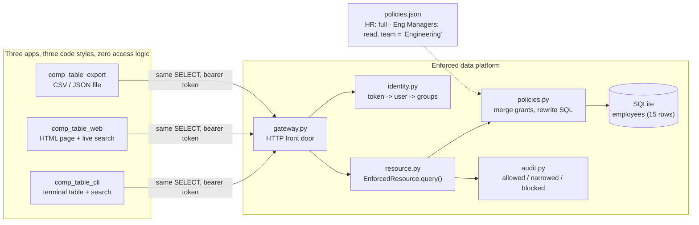
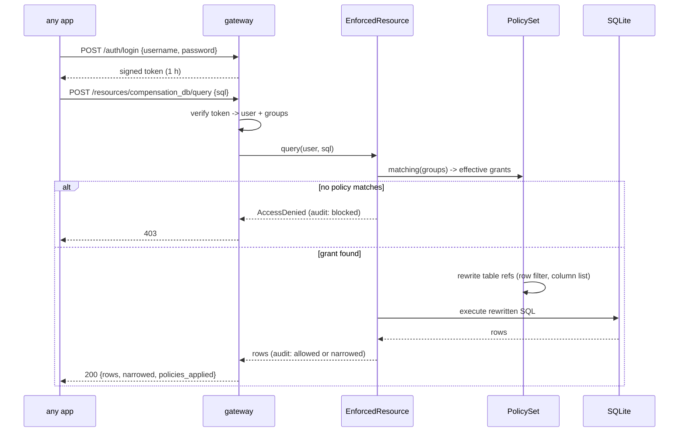

# Data Access Enforcement Gateway

Three "Team Compensation" apps, written three different ways, read the same
employee salary table. **None of them contains an access check.** Who sees
which rows is decided once, on the data connection, by a small enforcement
layer that every query passes through. Change the policy and all three apps
change behaviour; add a fourth app and it is covered the moment it connects.

The project is a self-contained Python model of the pattern that
platforms such as [Retool's data access enforcement](https://docs.retool.com/data-sources/concepts/data-access-enforcement)
and its [access policies](https://docs.retool.com/data-sources/concepts/access-policies)
implement for PostgreSQL resources, and that databases offer natively as
[row-level security](https://www.postgresql.org/docs/current/ddl-rowsecurity.html).
It uses [SQLGlot](https://github.com/tobymao/sqlglot) to parse and transform
SQLite statements before execution.

## Why

AI coding agents optimise for one thing: does the app they are building work.
They have no signal about what surrounds that app, so when asked to "only show
a manager their own team" each agent writes the check in its own way: a
`WHERE` clause here, a role check in a UI component there, a filter in a
backend function somewhere else. Ten internal tools means ten access checks,
written by different models, that nobody can see at once and nobody can prove
still agree. When the rule changes, someone has to find every copy. When one
app forgets the check, every row is exposed and nothing notices.

A better model or a better prompt does not fix this, because both shape one
app at a time. The fix is structural: move the decision out of the apps and
onto the connection they all share. Then the platform answers the questions
agents never reason about:

| Question | Where it is answered here |
|---|---|
| Which rows can this user query? | `row_filter` in `policies.json`, applied by SQL rewrite |
| Which columns should come back? | `columns` allow-list in the same policy |
| Who is this user, really? | signed bearer token from the gateway's login, never from the app |
| Is there a record of what they saw? | `enforcement/audit.py`: one JSON line per query, allowed / narrowed / blocked |

## What the demo shows

```
$ python demo.py
nina (HR)                  -> 15 rows in comp_table_cli, comp_table_web and comp_table_export
tom  (Engineering Manager) ->  5 rows in all three (team = 'Engineering'), narrowed server-side
ava  (Marketing)           -> HTTP 403 in all three: no policy covers her, the resource is closed
audit summary: {'allowed': 3, 'narrowed': 3, 'blocked': 3}
```

Every app sends the identical statement:

```sql
SELECT id, name, team, role, salary, last_raise FROM employees ORDER BY name
```

For Tom the gateway executes this instead, without the app knowing:

```sql
SELECT id, name, team, role, salary, last_raise
FROM (SELECT id, name, team, role, salary, last_raise FROM employees WHERE team = 'Engineering') AS employees
ORDER BY name
```

The table reference itself is replaced, so `... WHERE team = 'Sales' OR 1=1`
still returns five Engineering rows, and `UPDATE employees ...` is refused
because Tom's grant is read-only.

## Architecture



Request flow for one query:



## Code map

| Path | Responsibility |
|---|---|
| `policies.json` | **HR full access** (groups `hr`, `admin`, reads and row edits) and **Engineering Managers** (group `eng-managers`, read-only, `row_filter: team = 'Engineering'`, explicit column list). `"enforced": true` closes the resource to anyone not covered. |
| `enforcement/__init__.py`, `apps/__init__.py` | Package markers for the gateway and its clients. |
| `enforcement/db.py` | Creates and seeds the `employees` table: 15 synthetic people across Sales, Engineering (5) and Marketing with `salary` and `last_raise`. |
| `enforcement/identity.py` | Demo user directory (`nina`→`hr`, `tom`→`eng-managers`, `ava`→`marketing`, `admin`→`admin`) and HMAC-signed, expiring bearer tokens. Stands in for the platform's SSO. |
| `enforcement/policies.py` | Loads and merges grants, parses one SQLite statement with SQLGlot, and replaces every permitted table reference with a filtered derived table. Handles quoted names, schema qualification, comma joins, nested SELECTs and set operations. Rejects unknown tables and unsupported statement types. |
| `enforcement/audit.py` | Thread-safe append-only log; in memory plus optional JSONL file. `summary()` counts allowed / narrowed / blocked. |
| `enforcement/resource.py` | `EnforcedResource`: the only object that touches the database. Looks up grants, rewrites, executes, audits; raises `AccessDenied` otherwise. Usable directly in Python or behind the gateway. |
| `enforcement/gateway.py` | Stdlib `ThreadingHTTPServer` exposing `POST /auth/login`, `GET /me`, `POST /resources/<name>/query`, `GET /audit` (hr/admin only). Identity is taken from the token, never from the request body. `start_background()` is what the demo and tests use. |
| `apps/client.py` | Shared stdlib HTTP client and the one unfiltered `COMPENSATION_QUERY` every app sends. Knows a gateway URL and a login, never a database credential. |
| `apps/comp_table_cli.py` | App 1: procedural terminal table with `--search`. |
| `apps/comp_table_web.py` | App 2: one-page HTML table with a JavaScript search box, served by a tiny HTTP server. |
| `apps/comp_table_export.py` | App 3: class-based CSV/JSON exporter. |
| `demo.py` | Boots the gateway on a free port, runs all three apps as Nina, Tom and Ava, checks the three apps agree for each user, prints the audit log. Exit code 0 only if they agree. |
| `tests/test_enforcement.py` | 28 unit and integration tests covering the three apps, identity, audit, policy merging, row and column isolation, joins, nested queries, unsupported CTEs and writes. |

How the pieces fit: the apps depend only on `apps/client.py`; the client
depends only on the gateway's HTTP contract; the gateway depends on
`EnforcedResource`; the resource is the single choke point that combines
identity, policy and audit before SQLite is ever touched. Adding a fourth app
means writing another client of the same endpoint and nothing else.

## Run it

Python 3.10 or newer. SQLGlot is the single dependency; SQLite and HTTP use
the standard library.

```bash
git clone https://github.com/crzyc0d3r/data-access-enforcement-gateway.git
cd data-access-enforcement-gateway
python -m pip install -r requirements.txt

python demo.py                               # the whole story in one command
python -m unittest discover -s tests -v      # 28 tests
```

Run the pieces separately to poke at them:

```bash
# terminal 1: the enforced gateway (in-memory DB, seeded on start)
python -m enforcement.gateway --port 8780 --audit-log audit.jsonl

# terminal 2: the three apps, as different users
python -m apps.comp_table_cli    --user tom  --password tom-demo  --search eng
python -m apps.comp_table_export --user tom  --password tom-demo  --format csv
python -m apps.comp_table_web    --user nina --password nina-demo --port 8781   # then open http://127.0.0.1:8781
python -m apps.comp_table_cli    --user ava  --password ava-demo                # -> access denied
```

Or talk to the gateway directly:

```bash
TOKEN=$(curl -s -X POST localhost:8780/auth/login -d '{"username":"tom","password":"tom-demo"}' | python -c 'import json,sys;print(json.load(sys.stdin)["token"])')
curl -s -X POST localhost:8780/resources/compensation_db/query \
     -H "Authorization: Bearer $TOKEN" -d '{"sql":"SELECT name, salary FROM employees"}'
```

Demo logins: `nina`/`nina-demo` (HR), `tom`/`tom-demo` (Engineering
Manager), `ava`/`ava-demo` (Marketing, uncovered), `admin`/`admin-demo`.

### Try changing the rule

Edit `policies.json` and restart the gateway: for example give
`eng-managers` the column list without `salary`, or add a `sales-managers`
policy with `row_filter: "team = 'Sales'"`. No app changes. That is the point.

Set `GATEWAY_SIGNING_KEY` to a long random string if you run the gateway for
more than a demo so tokens survive restarts; otherwise a random key is
generated per process.

## Limits of this model

* The SQL parser supports SELECTs, set operations and row INSERT/UPDATE/DELETE.
  CTEs, SELECT INTO, EXPLAIN, PRAGMA, schema changes and attached databases
  are rejected. This is an educational gateway, not a production security
  product; use database-native row-level security for a production system.
* Identity is an in-memory directory with demo passwords. Replace
  `enforcement/identity.py` with your identity provider.
* SQLite stands in for PostgreSQL; the enforcement logic does not depend on
  it, but the rewritten SQL does assume ANSI-style derived tables, which
  PostgreSQL also accepts.
